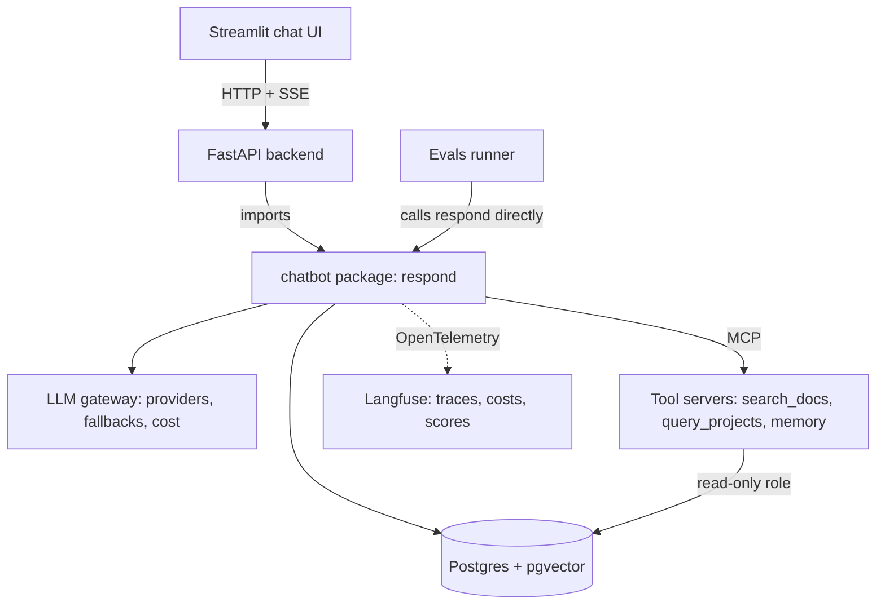

# Architecture

This document describes what the system looks like when the plan is finished
and why each choice was made. The order of work is in
[plan/PROJECT_PLAN.md](plan/PROJECT_PLAN.md).

## 1. Overview



One request, end to end:

1. The user types a message in Streamlit. Streamlit calls `POST /sessions/{id}/chat`.
2. The backend authenticates the user and calls
   `chatbot.respond(session_id, user_message, user)`.
3. `respond` loads the session history and builds the context for the model.
4. The agent loop calls the model. If the model asks for tools, the loop runs
   them and calls the model again, until there is a final answer or the step
   limit is reached.
5. Every message, tool call and tool result is saved to Postgres, and every
   step is recorded as a span in the trace.
6. Text is streamed back to the UI as it is produced.

## 2. Who owns what

| Role | Provides | In this repo |
|---|---|---|
| Data scientist | The brain: one function, `respond(...) -> stream`. Context building, agent loop, tools, retrieval, prompts, persistence of messages, traces, evals. | `chatbot/`, `mcp_servers/`, `evals/` |
| Backend engineer | Everything around the brain: auth, session listing and loading, streaming to the browser, rate limiting at the edge. Calls `respond` and reads the tables it writes. | `backend/` |
| Frontend | What the user sees: session list, conversation, streaming text, tool activity, thumbs up/down. | `frontend/` |

The contract between the data scientist and the backend is small on purpose:

```python
async def respond(session_id: UUID, user_message: str, user: User) -> AsyncIterator[Event]: ...
```

`Event` is a small set of typed events: `TextDelta`, `ToolCallStarted`,
`ToolCallFinished`, `TurnCompleted` (usage, cost, trace id) and `TurnFailed`.
The backend turns them into server-sent events without knowing what they mean.

Where the data scientist adds value is not the plumbing. It is retrieval
quality, tool design, prompts and evals.

Rules that keep the separation honest:

- `chatbot` never imports FastAPI or Streamlit. It can be run and tested from a
  CLI and from the evals runner with no web layer.
- `backend` contains no prompts, no tool logic and no LLM calls.
- `frontend` talks to the backend over HTTP only and never imports `chatbot`.

## 3. Design decisions

### 3.1 Framework: provider SDKs directly, no LangChain

The agent loop is small: call the model, run the requested tools, append the
results, repeat. Writing it ourselves keeps it debuggable and lets us use new
provider features (prompt caching, thinking, native tool types) as soon as they
exist.

To keep providers pluggable, the rest of the code talks to one interface:

```python
class LLMProvider(Protocol):
    name: str
    def stream(self, request: LLMRequest) -> AsyncIterator[LLMEvent]: ...
```

Each SDK (Anthropic, OpenAI) gets one adapter that converts our normalized
messages and tool definitions to the provider's format and converts its stream
back to our events. Adding a provider means adding one adapter class and one
line in the registry.

### 3.2 LLM gateway

The gateway is an in-process wrapper around providers. It owns the fallback
chain, retries with backoff, timeouts, and cost calculation from a price table.
It implements the same `LLMProvider` interface, so the agent does not know
whether it is talking to one provider or to a chain.

A LiteLLM proxy can be added later as just another adapter, when several teams
or apps share LLM access.

### 3.3 Tools over MCP, read-only

Tools start as plain typed functions (C09 to C20) and move behind MCP servers
(C22). MCP is worth it here because the same tools can then be used by other
clients, and different teams can own different servers.

Tool rules:

- A few high-level tools with clear descriptions, not many thin ones.
- Results are compact and paginated: a short list of items, a total count and
  a cursor for the next page. Large payloads never go into the context whole.
- All data tools are read-only. The only write tool is memory (section 3.7).
- The user's identity comes from the server side of the session and is passed
  to tools in a `ToolContext`. The model can never set or change it.

### 3.4 SQL: a read-only role over curated views, not raw tables

`query_projects` connects as `chatbot_ro`, a database role that can only
`SELECT` from views in the `curated` schema. Why:

1. **The model's output is untrusted.** A prompt injection or a plain mistake
   can make the model ask for anything. If the role cannot write, no prompt can
   make it write. Safety that lives in the database cannot be talked around.
2. **Least privilege.** Views expose only approved columns. Sensitive columns
   (personal data, rates, internal notes) are simply not there to leak.
3. **A stable contract.** Raw tables change with the product. Views are a
   contract we control, so tools, prompts and evals do not break when the
   underlying schema changes.
4. **Better answers.** Views are denormalized, with clear names and business
   meaning already applied (for example "active project"). The model sees a
   small, clean schema and makes fewer wrong joins.
5. **Guardrails on load.** The role has a statement timeout and row limits, and
   can later be pointed at a read replica.
6. **Easy to audit.** One role, one short list of grants.

The first version of `query_projects` takes typed filters (status, client,
date range, text search), not free SQL. A free-SQL tool restricted to the same
views can be added later if the typed filters prove too narrow.

### 3.5 RAG: hybrid search, reranker, access control

`search_docs` runs two searches in Postgres and merges them:

- Lexical: Postgres full-text search. This is the "BM25 leg". Postgres ranking
  is not true BM25, so the lexical leg sits behind an interface and can be
  swapped for a real BM25 implementation if evals show it matters.
- Semantic: pgvector cosine similarity over chunk embeddings.
- Fusion: reciprocal rank fusion, then a reranker on the top candidates.

Access control is a metadata filter applied inside both queries (never after
ranking): each chunk carries the groups allowed to read it, and the filter uses
the groups of the calling user from `ToolContext`.

### 3.6 History and context

Postgres is the source of truth. Tables: `sessions`, `turns`, `messages`.
Message content, tool calls and tool results are stored as JSONB in a
normalized, provider-neutral shape, so a session can be replayed against a
different provider.

What the user sees is always the full history. What the model sees is built
each turn by a context strategy:

| Strategy | What it does |
|---|---|
| `full` | Sends everything. Baseline for tests and short sessions. |
| `sliding_window` | System prompt plus the last N turns. |
| `compact_tools` | Replaces old tool results with a one-line note. |
| `summary` | Summarizes older turns once past a threshold, stores the summary on the session, sends summary plus recent turns. |

Strategies are composable and chosen by configuration. Summaries are made in
occasional large steps, not every turn, so the prompt prefix stays stable and
prompt caching keeps working.

### 3.7 Memory

Cross-session facts about the user, exposed to the model as a small read/write
tool. Off by default (`MEMORY_ENABLED=false`) and built late, because many
enterprise bots do not need it at first. Facts are visible to and deletable by
the user.

### 3.8 Tracing and audit

OpenTelemetry spans, exported to Langfuse. Hierarchy:

```
session
└── turn                      (one user message → one final answer)
    ├── llm call              tokens in/out, cached tokens, cost, latency, model
    ├── tool call             arguments, result size, latency, error
    └── llm call
```

Langfuse is for debugging, cost analysis and evals. It is not the system of
record. For compliance there is a separate append-only `audit_log` table in
Postgres: who asked what, which tools ran with which arguments, which data
sources were touched. The application role can insert into it but cannot
update or delete.

### 3.9 Database roles

| Role | Can do | Used by |
|---|---|---|
| `chatbot_owner` | Owns the schemas, runs migrations | The `migrate` job only |
| `chatbot_app` | Read/write history and memory, insert audit rows | `chatbot` package |
| `chatbot_ro` | `SELECT` on `curated` views and RAG tables | Tools |

### 3.10 Prompt injection

Retrieved documents are data, not instructions. Defenses, in layers:

- Tool results are wrapped and labeled as untrusted content, and the system
  prompt tells the model to never follow instructions found inside them.
- Data tools are read-only, so a successful injection cannot change data.
- User identity and permissions are enforced outside the model.
- The UI does not load remote images or auto-follow links from model output,
  which closes the usual data-exfiltration channel.
- The eval set contains documents with injected instructions, so regressions
  are caught.

## 4. Software design patterns

Used where they remove real duplication or make testing easier, not for their
own sake.

| Pattern | Where | Why |
|---|---|---|
| Adapter | Provider SDKs → `LLMProvider` | One normalized message and event format. |
| Strategy | Context strategies, rerankers, embedders, lexical search | Swap by configuration, compare in evals. |
| Registry / factory | `provider:model` strings → provider; tool name → tool | New provider or tool is one registration. |
| Decorator | Gateway wraps a provider with retries, fallbacks, cost metering | Same interface, layered behavior. |
| Repository | Sessions, messages, memory, audit | SQL in one place; in-memory fakes for unit tests. |
| Composition root | `build_chatbot(settings)` | All wiring in one function; no hidden globals. |

## 5. Debuggability

- One `turn_id` and one `trace_id` per turn, present in every log line, every
  saved message and the response to the UI.
- Structured logs (`LOG_FORMAT=json`) and readable console logs for local work.
- `LOG_LEVEL=DEBUG` prints the exact context sent to the model.
- A CLI (`python -m chatbot.cli chat`) runs the agent without the web layer.
- A scripted fake provider makes agent tests deterministic and free.
- Typed errors (`ToolError`, `ProviderError`, `ContextOverflow`, ...) instead
  of bare exceptions, each recorded on the span where it happened.
- A session can be replayed from the database against any provider or prompt.
